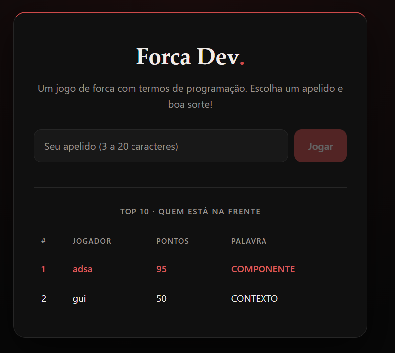
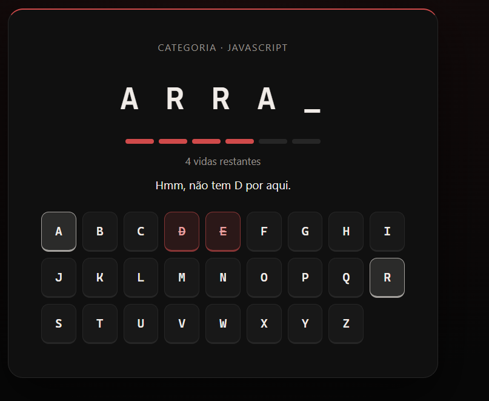

# Forca Dev

Jogo da forca com termos de programação. O jogador informa um apelido, o servidor sorteia uma palavra secreta guardada no banco, e o jogador chuta letras. Com 6 erros, perde; revelando a palavra, vence, ganha pontos e entra no ranking top 10.

A palavra secreta fica **só no servidor**: o front recebe apenas a máscara (ex.: `PR_M_SE`) e só vê a palavra quando a partida termina.





## Tecnologias

- **Back-end:** Node.js, TypeScript, Fastify, Prisma ORM 6.19.3 com SQLite, Zod
- **Testes:** Vitest (com `app.inject` do Fastify)
- **Front-end:** React, TypeScript e Vite

## Pré-requisitos

- Node.js 20 ou superior (com npm)
- Git

## Como rodar

### 1. Clonar o repositório

```bash
git clone https://github.com/GuiSohne-dq/Avaliacao-Forca-Dev.git
cd Avaliacao-Forca-Dev
```

### 2. Back-end

```bash
cd backend
npm install
cp .env.example .env
npx prisma migrate dev
npm run seed
npm run dev
```

O que cada passo faz:

| Comando | Para que serve |
|---|---|
| `npm install` | instala as dependências |
| `cp .env.example .env` | cria o arquivo de configuração com `DATABASE_URL="file:./forca.db"` (no CMD do Windows use `copy .env.example .env`) |
| `npx prisma migrate dev` | cria o banco SQLite, aplica a migration e gera o Prisma Client |
| `npm run seed` | cadastra as palavras (mais de 20, em 3 categorias); pode rodar mais de uma vez |
| `npm run dev` | sobe a API em `http://localhost:3333` |

### 3. Front-end

Em outro terminal:

```bash
cd frontend
npm install
npm run dev
```

Abra `http://localhost:5173`. O Vite repassa as chamadas `/api` para a API na porta 3333, então a API precisa estar rodando.

### Atalho: subir tudo com um comando

Depois de rodar o `npm install` no `backend` e no `frontend`, dá para subir os dois juntos pela raiz do projeto:

```bash
npm install
npm run dev
```

## Como rodar os testes

```bash
cd backend
npm test
```

São 14 testes: 8 sobre as regras do jogo (funções puras) e 6 sobre a API. Os testes usam um banco próprio (`prisma/test.db`, criado automaticamente), então o banco do jogo não é alterado.

## Regras do jogo

- A partida começa com 6 vidas; cada letra errada consome 1.
- O palpite é exatamente uma letra de A a Z; letra já tentada responde 409 e não consome vida.
- Partida encerrada não aceita palpites.
- Pontos na vitória = vidas restantes × 10 + letras distintas da palavra × 5. Derrota vale 0.
- Ranking = 10 vitórias com mais pontos; no empate, quem terminou primeiro fica à frente.

Também é possível jogar digitando as letras no teclado.

## API

| Método e rota | Descrição |
|---|---|
| `POST /api/partidas` | cria uma partida (`{ "jogador": "ana" }`) |
| `GET /api/partidas/:id` | estado atual da partida |
| `POST /api/partidas/:id/palpites` | envia um palpite (`{ "letra": "a" }`) |
| `GET /api/ranking` | top 10 vitórias |


## Estrutura de pastas

```
forca-dev/
├── backend/
│   ├── prisma/            schema.prisma e migrations/
│   ├── src/
│   │   ├── database/      prisma.ts (client único) e seed.ts
│   │   ├── game/          regras.ts (funções puras)
│   │   ├── repositories/  acesso ao banco
│   │   ├── services/      regras + banco
│   │   ├── controllers/   handlers das rotas
│   │   ├── routes/        plugin Fastify
│   │   ├── schemas/       validação com Zod
│   │   ├── app.ts         criação do app e tratamento de erros
│   │   ├── server.ts      sobe o servidor
│   │   ├── errors.ts
│   │   └── types.ts
│   └── tests/             regras.test.ts e api.test.ts
├── frontend/              React + Vite + TypeScript
├── docs/                  planejamento, api, decisões e diário de bordo
└── README.md
```

## Documentação

- [docs/planejamento.md](docs/planejamento.md): tabelas, rotas, tipos e ordem de trabalho
- [docs/api.md](docs/api.md): contrato completo da API
- [docs/decisoes.md](docs/decisoes.md): decisões técnicas
- [docs/diario-de-bordo.md](docs/diario-de-bordo.md): diário de bordo

## Problemas comuns

| Mensagem | Solução |
|---|---|
| `Environment variable not found: DATABASE_URL` | crie o `backend/.env` a partir do `.env.example` |
| `@prisma/client did not initialize yet` | rode `npx prisma generate` em `backend` |
| `The table ... does not exist` | rode `npx prisma migrate dev` em `backend` |
| Front mostra "Servidor fora do ar" | confira se a API está rodando na porta 3333 |
